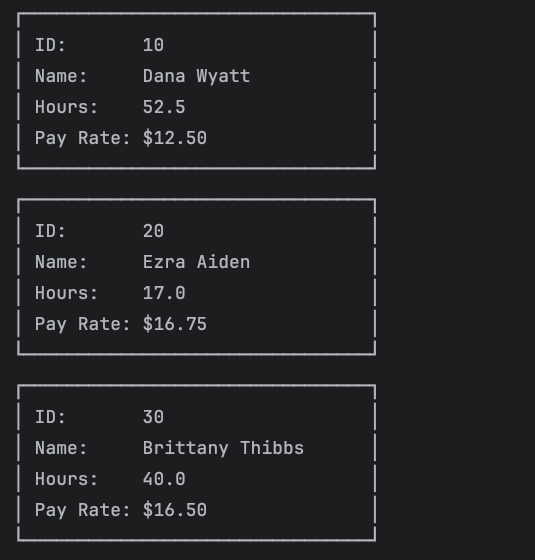

# Payroll Calculator

A command-line app that reads employees from a file and then generates a payroll report from the data.

## Features

- Prompt the user for the employees file name
- Prompt the user for a payroll report file name
- Load all **employee data**
- Write a payroll report 

## How to run it

1. Open the project in IntelliJ
1. Run `App.java`
1. Type a employee file name, like `employees.csv`

## Interesting code

```java
public static void main(String[] args) {
        List<Employee> employees = loadEmployees();
        
        printEmployeeCards(employees);
        printEmployeeTable(employees);
 }
```

## Screenshots





